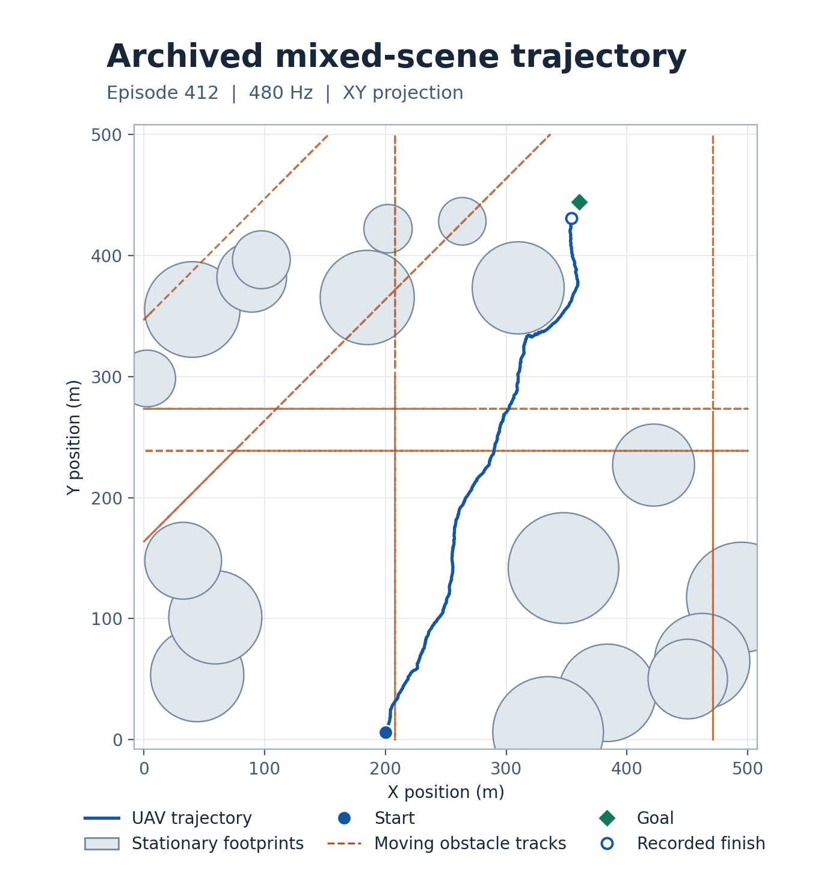

# Autonomous Drone Navigation based on Reinforcement Learning integrated with Artificial Potential Field

**Ming-Chieh Liu · Chen-Yang Lan**  
Department of Mechanical Engineering, National Taiwan University of Science and Technology, Taipei, Taiwan

Research software and simulation data for the accompanying manuscript on learning-assisted local drone navigation.

[Run the simulator](#quick-start) · [Explore the data](#simulation-data) · [Reproduce the results](docs/reproduction.md) · [Zenodo archive v0.1.0](https://doi.org/10.5281/zenodo.24494002)



*Archived SAC + VOAPF 2.0 episode 412, simulated at 480 Hz. The scene has 20 static and six moving obstacles. The moving-obstacle lines show recorded center positions.* [Trajectory data](data/historical/mixed-480hz/episode-412.json) · [Plotting script](scripts/plot_archived_trajectory.py)

## Method

A Soft Actor–Critic (SAC) policy uses a 121-cell local ray-casting map and five kinematic features to tune the artificial potential field (APF) navigator. The policy adjusts steering bias and attraction and repulsion gains. VOAPF 2.0 adds directional virtual obstacles when the drone's recent displacement indicates stagnation.

The manuscript evaluates fixed-altitude planar navigation in randomized static and mixed scenes, including asynchronous control and sensor updates. The simulator models a 500 × 500 m horizontal workspace. The 480 Hz mode models 20 Hz RTK and 10 Hz LiDAR updates.

## Quick start

From the repository root in Windows PowerShell, create an environment and install the pinned dependencies. The smoke tests were verified on Windows x64 with Python 3.9.9 and PyTorch 2.5.1 on CPU. The standard simulator can run without a database server or hardware.

```powershell
py -3.9 -m venv .venv
$python = ".\.venv\Scripts\python.exe"
& $python -m pip install -r requirements.txt
& $python -m unittest discover -s tests -v
& $python simulator.py --scene static --hardware-hz 0 --uav-speed 1 --episodes 1 --max-seconds 2 --no-train
& $python simulator.py --scene mixed --hardware-hz 1 --uav-speed 4 --episodes 1 --max-seconds 2 --no-train
```

In a fresh checkout, these two smoke runs end at the two-second time limit. Expect 2 and 960 control updates and path lengths of approximately 2 and 8 m. Scores and TensorBoard logs are written to `logs/`. HTML and JSON trajectories are written to `DataBase/experience/`. [Expected outputs and schema](data/examples/README.md)

To regenerate the figure, run `& $python scripts/plot_archived_trajectory.py` from the repository root.

## Simulation data

| Included data | Coverage |
| --- | --- |
| [Verified examples](data/examples/) | Two fresh-checkout smoke runs with score summaries and trajectory JSON |
| [Archived SAC + VOAPF 2.0](data/historical/README.md#sac--voapf-20-s2r) | Three 480 Hz training runs with 1,000 episode scores and one representative trajectory each |
| [Archived DDPG and TD3](data/historical/ddpg-td3-success.csv) | Episode outcomes for seven runs extracted from TensorBoard, 7,000 rows total |
| [Provenance manifest](data/historical/manifest.csv) | Source paths and SHA-256 values for archived data and associated SAC checkpoints |

The three archived SAC runs have final exponentially smoothed success values of 86.78% (mixed), 79.22% (static, 1 m/s), and 85.64% (static, 4 m/s), using `β = 0.99` and initial value 0. The archived outcomes can be recomputed from the included CSV files. The manuscript's Figure 15 reports 98.1% and 95.3% for its mixed and static runs. The run identifiers for those curves are still to be confirmed. [Reproduction guide](docs/reproduction.md) · [Paper figure coverage](docs/release-checklist.md)

## Repository map

| Location | Contents |
| --- | --- |
| [`simulator.py`](simulator.py) and [`config/`](config/) | Current SAC + VOAPF simulation and experiment settings |
| [`Agents/`](Agents/), [`Envs/`](Envs/), [`Obstacles/`](Obstacles/), [`Trainer/`](Trainer/) | Agent dynamics, environments, obstacle models and learning algorithms |
| [`baselines/`](baselines/) | Independent DDPG + APF, TD3 and earlier SAC snapshots with their own configurations |
| [`data/`](data/) and [`scripts/`](scripts/) | Simulation data and figure generation |
| [`docs/`](docs/) and [`tests/`](tests/) | Reproduction instructions, artifact status and simulator regression tests |

## Citation

Cite the Zenodo version DOI for analyses using the `v0.1.0` software and packaged simulation data. Use GitHub's **Cite this repository** entry for a formatted citation, and cite the accompanying manuscript by its title and authors. [Version 0.1.0 DOI](https://doi.org/10.5281/zenodo.24494002) · [GitHub release](https://github.com/HortonLiu/DQN-based-UAV-3D_path_planer/releases/tag/v0.1.0) · [`CITATION.cff`](CITATION.cff)

## Acknowledgments and licenses

The research software is licensed under MIT. The packaged simulation scores, episode outcomes, and trajectory data are licensed under CC BY 4.0. [Software license](LICENSE) · [Simulation data license](data/LICENSE)

The simulator builds on the RLGF project by young how. The upstream copyright notice and the licenses for the adapted training examples and offline chart bundles accompany the software. [RLGF upstream](https://github.com/young-how/DQN-based-UAV-3D_path_planer) · [Training code notices](licenses/) · [Chart bundle notices](assets/pyecharts/)
